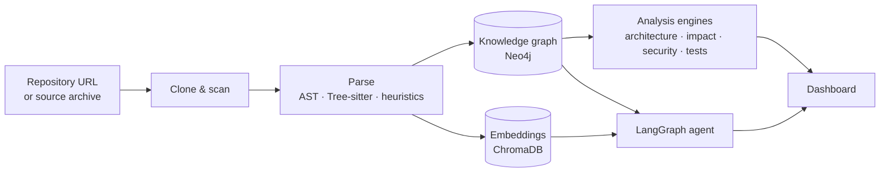

<div align="center">

# Engineering Intelligence Platform

**Understand any codebase in minutes — not weeks.**

Point the platform at a Git repository and get an evidence-backed picture of what the software does, how it is built,
what will break when it changes, and where the risks are.


[Features](#features) · [How it works](#how-it-works) · [Quick start](#quick-start) · [Configuration](#configuration) · [Documentation](#documentation)

</div>

---

## Why this exists

Every engineering organisation has the same problem: the people who understood a system have moved on, the
documentation is out of date, and the codebase is too large for anyone to hold in their head. New joiners spend weeks
finding their way around. Architects review designs they cannot fully see. Reviewers approve pull requests without
knowing what else depends on the code being changed.

The Engineering Intelligence Platform reads a repository the way an experienced engineer would — entry points,
modules, APIs, data model, dependencies, configuration — and turns it into something a team can actually use:
a navigable knowledge graph, an architecture overview, change-impact analysis, security and test insights, and an
assistant you can ask questions in plain English.

It is built for the codebases that are hardest to understand: Java and Spring monoliths, .NET services, Python and
Node.js applications, multi-module builds and microservice estates.

## Features

### Understand
- **Deep Report** — a structured account of what the project does and how it works: technology stack, startup,
  modules, API catalog, request flows, events, data model, key components, security mechanisms and configuration.
  **Every statement links to the exact file and line it was derived from**, and anything that could not be
  determined is listed explicitly rather than guessed.
- **Purpose & Adoption** — what problem the repository solves, its business domain, how to run it, which environment
  variables it needs, an enterprise-readiness checklist with licence guidance, and concrete suggestions on what to
  reuse, what to build next and what to improve. Describe your own goal and the platform scores how well the
  codebase fits it.
- **Onboarding guide** — a recommended reading order, the most important files, a domain glossary and an explainer
  for large files.

### Visualise
- **Architecture explorer** — detected architecture style, layers, service dependencies, business capabilities,
  messaging topology, dependency cycles, god classes, code ownership and hotspots, with generated diagrams.
- **Knowledge graph viewer** — browse Repository → Services → APIs → Classes → Functions → Databases, search any
  symbol and expand its neighbourhood.

### Change safely
- **Impact analysis** — select a file or function and see the affected services, APIs, data stores and tests, with
  the dependency chains that connect them.
- **Pull request intelligence** — paste a GitHub PR link or a diff to get a risk score with its contributing factors,
  security issues in the added code, API and schema changes, new cross-module dependencies, missing tests and review
  comments.

### Assure quality
- **Security intelligence** — hard-coded secrets (masked in all output), injection risks, authentication and
  cryptography weaknesses, misconfigurations and vulnerable dependencies (via OSV.dev).
- **Test intelligence** — estimated coverage, regression-risk ranking, prioritised recommendations and generated
  unit and integration test scaffolding for JUnit, pytest, xUnit, Jest and Go.

### Ask
- **Repository chat** — ask *"Where is authentication implemented?"*, *"Which services depend on PaymentService?"* or
  *"What happens if I change this API?"* and get answers grounded in the knowledge graph and the retrieved source,
  with citations. When an LLM is used, every code reference in the answer is checked against the repository and
  anything that cannot be verified is flagged.

## How it works



1. **Ingest** — the repository is cloned (tokens for private repositories are used once and never stored) and every
   file is classified by language and role.
2. **Parse** — source files are parsed into a common model of modules, classes, functions, imports, calls, endpoints,
   data access and messaging, regardless of language.
3. **Connect** — these facts become a knowledge graph, and the code, documentation and configuration are indexed for
   semantic search.
4. **Analyse** — dedicated engines derive architecture, impact, security, test and adoption insights from the graph.
5. **Explain** — the dashboard and the chat agent present the results, always pointing back to the source.

Every external service is optional. Without Neo4j, ChromaDB, PostgreSQL or an LLM key, the platform falls back to an
embedded graph store, a local vector index, SQLite and deterministic, citation-backed answers — so it runs on a
laptop with no infrastructure, and upgrades automatically when the full stack is available.

## Quick start

### With Docker (recommended)

```bash
git clone https://github.com/haarikaalla/engineering-intelligence-platform.git
cd engineering-intelligence-platform
cp .env.example .env            # set database passwords; optionally add an OpenAI or Anthropic key
docker compose up -d --build
```

Open **http://localhost:3000**, paste a repository URL and select **Analyze repository**.

| Service | Address |
|---|---|
| Dashboard | http://localhost:3000 |
| API & OpenAPI docs | http://localhost:8000/docs |
| Neo4j Browser | http://localhost:7474 |

### Without Docker

```bash
# Backend
cd backend
python -m venv .venv
source .venv/bin/activate        # Windows: .venv\Scripts\activate
pip install -r requirements.txt  # or requirements-dev.txt for a minimal install
uvicorn app.main:app --reload --port 8000

# Frontend (in a second terminal)
cd frontend
npm install
npm run dev
```

See the [setup guide](docs/SETUP.md) for prerequisites and optional components.

## Configuration

All settings are environment variables; [`.env.example`](.env.example) lists them with sensible defaults.

| Variable | Purpose |
|---|---|
| `OPENAI_API_KEY` / `ANTHROPIC_API_KEY` | Enables LLM-written explanations, PR reviews and test generation |
| `LLM_PROVIDER` | `auto`, `openai`, `anthropic` or `none` |
| `EMBEDDING_PROVIDER` | `auto`, `openai` or `local` (keeps source code on-premises) |
| `GITHUB_TOKEN` | Default token for private repositories |
| `ALLOWED_GIT_HOSTS` | Git hosts that may be cloned — add your GitHub Enterprise or GitLab server here |
| `API_KEY` | Protects the backend API; the dashboard injects it server-side |
| `DATABASE_URL`, `NEO4J_URI`, `CHROMA_HOST` | Point at managed PostgreSQL, Neo4j and ChromaDB instances |
| `ENABLE_OSV` | Dependency vulnerability lookups; disable in air-gapped environments |

## Technology

| Layer | Stack |
|---|---|
| Frontend | Next.js 14, TypeScript, Tailwind CSS, Cytoscape.js, Mermaid |
| Backend | FastAPI, SQLAlchemy, Pydantic |
| Code analysis | Python AST, Tree-sitter, language-aware heuristics |
| Knowledge graph | Neo4j (with an embedded fallback) |
| Retrieval | ChromaDB, hybrid vector + BM25 search |
| AI orchestration | LangGraph, LangChain, OpenAI and Anthropic Claude |
| Persistence | PostgreSQL (SQLite for local development) |
| Delivery | Docker, Docker Compose, Kubernetes (Kustomize) |

## Project structure

```
engineering-intelligence-platform/
├── backend/
│   ├── app/
│   │   ├── ingestion/     # cloning, scanning, manifests, infrastructure discovery, pipeline
│   │   ├── parsing/       # language parsers and semantic extractors
│   │   ├── graph/         # knowledge graph builder, store and Neo4j mirror
│   │   ├── rag/           # chunking, embeddings, vector store, hybrid retrieval
│   │   ├── analysis/      # architecture, report, purpose, impact, PR, security, tests, scoring
│   │   ├── llm/           # LangGraph agent, providers, grounding checks
│   │   └── api/           # REST endpoints
│   └── tests/             # end-to-end and unit tests
├── frontend/              # Next.js dashboard
├── deploy/k8s/            # Kubernetes manifests
└── docs/                  # architecture, setup, deployment, example workflow
```

## Testing

```bash
cd backend
pytest -q
```

The end-to-end suite builds a small multi-service repository — two Spring Boot services connected by Kafka and a
FastAPI service — runs the full pipeline against it and verifies every API, including that each fact in the Deep
Report points to a real file and line.

## Security and privacy

- Repository access tokens are passed to Git for a single clone and are never written to disk or the database.
- Only `https://` URLs on allow-listed hosts are accepted, preventing server-side request forgery and Git option
  injection.
- Uploaded archives are checked for path traversal, symbolic links and decompression bombs.
- Detected secrets are masked in every response, and configuration values are never displayed.
- With `LLM_PROVIDER=none` and `EMBEDDING_PROVIDER=local`, no source code leaves your environment.

## Documentation

| Guide | Contents |
|---|---|
| [Architecture](docs/ARCHITECTURE.md) | Design decisions, data model, pipeline and agent design |
| [Setup](docs/SETUP.md) | Local development, optional components, configuration reference |
| [Deployment](docs/DEPLOYMENT.md) | Container images, Docker Compose, Kubernetes, scaling and air-gapped operation |
| [Example workflow](docs/EXAMPLE_WORKFLOW.md) | A walkthrough on a real open-source Spring application |

## Roadmap

- Side-by-side comparison of candidate repositories
- Cross-repository dependency analysis across an organisation
- GitHub Action that posts risk and impact analysis on every pull request
- Guided monolith-to-microservices decomposition
- Continuous documentation export to Confluence and Markdown

## Contributing

Contributions, bug reports and ideas are welcome. Please open an issue to discuss significant changes before
submitting a pull request, and make sure `pytest` passes and the frontend builds (`npm run build`).

## Licence

A licence has not yet been chosen for this project. Until one is added, please contact the author before reusing the
code.
