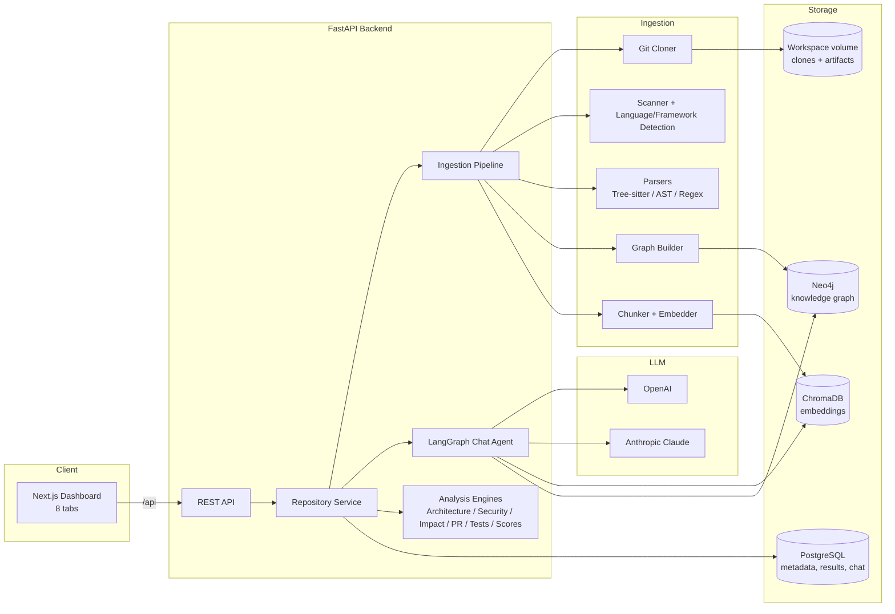
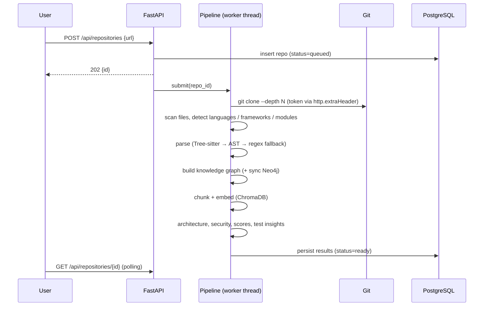
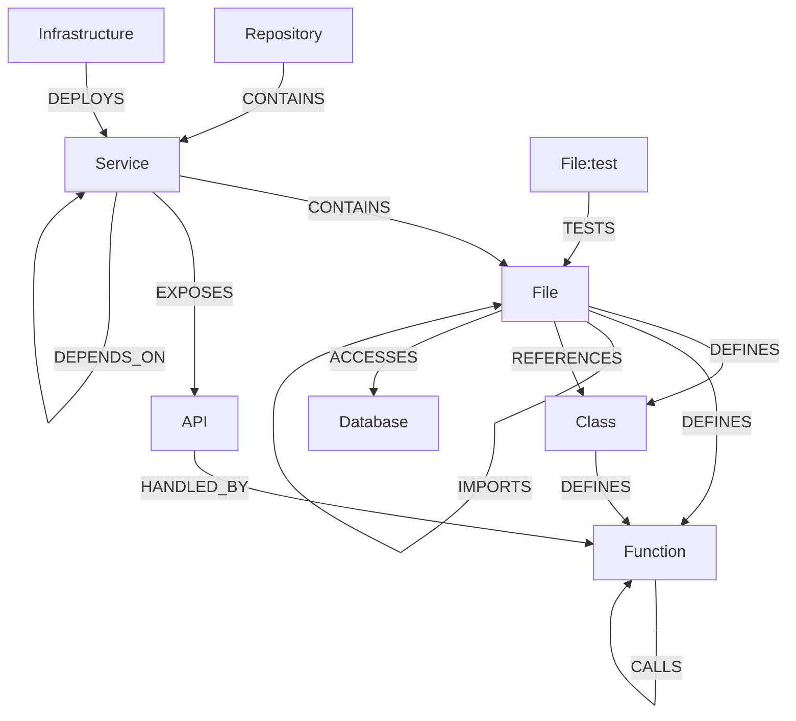
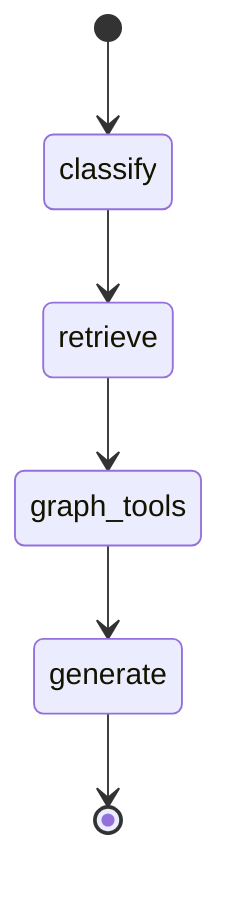

# Architecture & Implementation Plan

## 1. Architecture analysis

The platform has to ingest *arbitrary* repositories — from a 50-file Python
service to a multi-million-line Java monolith — and answer questions that need
both **semantic** context (what does this code mean?) and **structural**
context (what depends on what?). That drives three design choices:

1. **Language-agnostic intermediate model.** Every parser (Tree-sitter, Python
   `ast`, regex fallback) emits the same `ParsedFile` structure (symbols,
   imports, calls, endpoints, DB access). All downstream engines operate on this
   model, so adding a language means adding one parser, not touching engines.
2. **Dual index: vectors + graph.** RAG (ChromaDB) answers "where/what"
   questions; the knowledge graph (Neo4j or the embedded graph store) answers
   "who depends on / what breaks" questions. The chat agent (LangGraph) routes
   between them and fuses the results.
3. **Graceful degradation.** Every external system is optional at runtime:
   Neo4j → embedded graph, ChromaDB → embedded NumPy vector store, OpenAI/Claude
   → deterministic offline reasoning, Tree-sitter → regex parser,
   PostgreSQL → SQLite. Production uses the full stack; dev laptops and CI run
   with zero infrastructure.



## 2. Ingestion pipeline



Stages and their progress are persisted, so the UI shows live progress and
failures are reported with sanitized error messages (tokens are never logged or
stored).

## 3. Knowledge graph model



Node IDs are deterministic (`file:src/a.py`, `class:src/a.py#User`,
`api:GET /users`), so incremental re-analysis and Neo4j `MERGE` are idempotent.

## 4. Chat agent (LangGraph)



* **classify** – rule-based intent detection (overview, locate, dependents,
  impact, database, security, tests, general) + entity extraction.
* **retrieve** – hybrid search: vector similarity + keyword re-rank + symbol
  name boosting.
* **graph_tools** – deterministic graph queries chosen by intent (reverse
  dependencies, impact analysis, DB accessors…).
* **generate** – LLM (OpenAI / Claude through LangChain) grounded on the
  retrieved context, with source citations. Without an API key the agent
  returns a structured, citation-backed answer built from the same evidence.

## 5. Scoring model

| Score | Inputs |
|---|---|
| Security | weighted findings (critical 15, high 8, medium 3, low 1) normalised per KLOC |
| Architecture | module dependency cycles, average coupling, god classes, layering |
| Maintainability | function length, cyclomatic complexity, file size, TODO/FIXME density |
| Test | share of source files with associated tests |
| Health | weighted mean (security 30%, architecture 25%, maintainability 25%, tests 20%) |

## 6. Project structure

```
engineering-intelligence-platform/
├── backend/
│   ├── app/
│   │   ├── main.py                 # FastAPI app factory
│   │   ├── config.py               # pydantic-settings
│   │   ├── api/                    # routers + auth dependency
│   │   ├── db/                     # SQLAlchemy engine + models
│   │   ├── ingestion/              # cloner, scanner, frameworks, pipeline
│   │   ├── parsing/                # tree-sitter, python ast, regex, extractors
│   │   ├── graph/                  # graph store (memory/Neo4j) + builder
│   │   ├── rag/                    # chunker, embeddings, vector store, retriever
│   │   ├── analysis/               # architecture, security, impact, pr, testgen, scoring
│   │   ├── llm/                    # provider + LangGraph agent
│   │   └── services/               # repository service (artifact access)
│   ├── tests/
│   ├── Dockerfile
│   └── requirements.txt
├── frontend/                       # Next.js 14 + TS + Tailwind
│   └── src/{app,components,lib}
├── deploy/k8s/                     # Kustomize manifests
├── docker-compose.yml
└── docs/                           # architecture, setup, deployment, example workflow
```

## 7. Scalability notes for enterprise repositories

* Files larger than `MAX_FILE_SIZE_KB` and vendored/generated directories are
  skipped; per-repo file cap `MAX_FILES` guards memory.
* Parsing runs in a process-independent, side-effect-free way and can be moved
  to a worker queue (Celery/Arq) by replacing `JobRunner` — the pipeline is a
  pure function of `repo_id`.
* Embeddings and Neo4j writes are batched (`UNWIND`, 256–500 items).
* Graph artifacts are cached per repo on the workspace volume; API reads are
  served from memory after first load (LRU).
